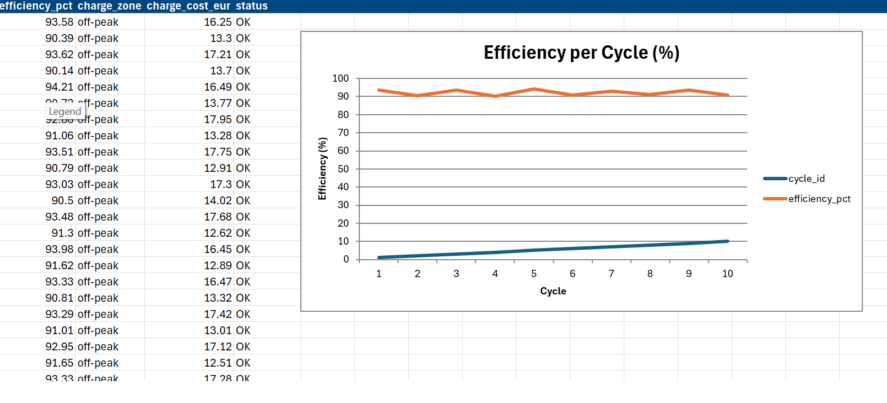

# BESS Performance Tracker

> **All data in this project is synthetic.** Generated by `python/generate_data.py`
> with degradation and cycle depth effects built in. This project demonstrates
> the analytical pipeline — data model, SQL queries and automated reporting —
> not findings about real batteries.

An end-to-end Battery Energy Storage System (BESS) performance tracking
project built with Python, SQL and Excel VBA — from synthetic data generation
to a fully automated 5-sheet Excel dashboard.

---

## Project Overview

This project simulates a real-world BESS monitoring and reporting workflow:

1. **Python** generates 730 days of realistic battery cycle data with built-in
   degradation trends and cycle depth dependent efficiency, injected directly
   into a SQLite database
2. **SQL** analyses the data across 9 queries — covering efficiency, charging
   costs, degradation tracking, peak shaving savings and cycle depth analysis
3. **Excel VBA** reads the SQL output automatically and builds a 5-sheet
   dashboard with formatted tables and charts — no manual work required

---

## Tools and Technologies

| Tool | Purpose |
|---|---|
| Python 3 | Synthetic data generation, database population |
| SQLite / DB Browser | Relational database storage |
| SQL | Data analysis and KPI calculation |
| Excel VBA | Dashboard automation and chart generation |

---

## Database Schema

### `site_info`
Metadata for each BESS site.

| Column | Type | Description |
|---|---|---|
| site_id | INTEGER | Primary key |
| site_name | TEXT | Site identifier |
| location | TEXT | Physical location |
| capacity_kwh | REAL | Total battery capacity (kWh) |
| max_power_kw | REAL | Maximum charge/discharge power (kW) |

### `tariff_zones`
Synthetic time-of-use tariff rates mapped to each hour of the day.

| Column | Type | Description |
|---|---|---|
| hour | INTEGER | Hour of day (0–23) |
| zone | TEXT | off-peak / shoulder / peak |
| rate_eur_kwh | REAL | Electricity rate (EUR/kWh) — synthetic value |

### `battery_cycles`
One record per charge/discharge cycle per site.

| Column | Type | Description |
|---|---|---|
| cycle_id | INTEGER | Primary key |
| site_id | INTEGER | Foreign key → site_info |
| cycle_date | TEXT | Date of cycle |
| charge_start | TEXT | Charge start time |
| charge_end | TEXT | Charge end time |
| discharge_start | TEXT | Discharge start time |
| discharge_end | TEXT | Discharge end time |
| energy_in_kwh | REAL | Energy charged (kWh) |
| energy_out_kwh | REAL | Energy discharged (kWh) |
| soc_start | REAL | State of charge at start (%) |
| soc_end | REAL | State of charge at end (%) |
| cycle_depth | REAL | Throughput fraction (energy_in / capacity) — see metrics note |

---

## Python Data Generator

`python/generate_data.py` populates the database with 730 realistic cycles:

- 365 days × 2 sites = 730 cycles
- Charge windows set to off-peak hours (01:00 to 07:00)
- Discharge windows set to peak hours (08:00 to 20:00)
- Built-in degradation: BESS_North loses ~1.85% efficiency over the year,
  BESS_South loses ~2.76%
- Cycle depth calculated per cycle as energy_in / site capacity
- RTE penalty applied as a function of cycle depth, informed by
  Preger et al. (Sandia National Laboratories, J Electrochem Soc 2020)
  which studied RTE variation with cycling conditions. Values here are
  adapted assumptions, not direct measurements from that paper.
- Random noise added with fixed seed (RANDOM_SEED = 42) for reproducibility
- The generator fills existing tables only — run `01_create_tables.sql`
  first to create the schema before running this script

---

## SQL Queries

| File | Description |
|---|---|
| `01_create_tables.sql` | Creates all three database tables |
| `02_efficiency_per_cycle.sql` | Round-trip efficiency per cycle |
| `03_charging_cost.sql` | Charging cost using synthetic time-of-use tariffs |
| `04_performance_summary.sql` | Full performance summary with status flag |
| `05_site_summary.sql` | Aggregated KPIs per site |
| `06_monthly_summary.sql` | Monthly efficiency, energy and cost per site |
| `07_degradation_trend.sql` | Monthly efficiency degradation vs January baseline |
| `08_peak_shaving_savings.sql` | Monthly net savings from peak/off-peak arbitrage |
| `09_rte_vs_cycle_depth.sql` | RTE vs cycle depth analysis by band and site |

---

## Key Metrics

| Metric | Formula | Note |
|---|---|---|
| Round-trip efficiency | (energy_out / energy_in) × 100 | |
| Cycle depth | energy_in / site capacity | Throughput fraction — not a true C-rate. A true C-rate divides power (kW) by capacity (kWh) using charge duration from charge_start and charge_end |
| Charging cost | energy_in × off-peak tariff rate | Synthetic tariff |
| Discharge revenue | energy_out × peak tariff rate | Synthetic tariff |
| Net peak shaving saving | discharge revenue − charging cost | Based on synthetic tariffs — not a real-world result |
| Degradation | monthly avg efficiency − January baseline | |
| Status flag | OK if efficiency ≥ 90%, else Below target | |

---

## Excel VBA Dashboard

`vba/BuildDashboard.bas` builds the full 5-sheet dashboard automatically
from CSV files exported from SQL queries.



### Sheet 1 — Dashboard
- 730 rows of cycle-level performance data
- Blue header row, red highlighting for Below target cycles
- Line chart: efficiency trend across all 730 cycles

### Sheet 2 — Monthly
- 24 rows — 12 months × 2 sites
- Monthly aggregation of efficiency, energy output and charging cost

### Sheet 3 — Degradation
- 24 rows showing monthly efficiency vs January baseline
- Line chart: degradation curve for both sites over 12 months

### Sheet 4 — Peak Shaving
- 24 rows showing monthly charge cost, discharge revenue and net saving
- Bar chart: monthly net savings per site — based on synthetic tariffs

### Sheet 5 — Cycle Depth Analysis
- 6 rows — 3 cycle depth bands × 2 sites
- Bar chart: average efficiency per cycle depth band per site
- Shows RTE decreasing as cycle depth increases on both sites

---

## Results on the Synthetic Dataset

**Efficiency:**
- BESS_North averages 92.5% round-trip efficiency — above 90% target all year
- BESS_South averages 89.59% — below target from June 2024 onwards

**Pipeline validation:**
- The generator builds in ~1.85% (BESS_North) and ~2.76% (BESS_South)
  efficiency loss over the year. The degradation query returns −1.85% and
  −2.76%, confirming the analysis correctly recovers the input parameters.
  The gap between the two sites is the ratio of the two input rates, not
  an independent discovery.

**Cycle depth analysis:**
- BESS_South averages 0.487 cycle depth vs 0.475 for BESS_North
- BESS_South spends 171 of 365 cycles in the high band vs 74 for BESS_North
- Efficiency falls as cycle depth increases on both sites
- The RTE penalty function is informed by Preger et al. (Sandia, 2020) but
  uses cycle depth as a proxy. Values are adapted assumptions, not direct
  measurements from that paper.

**Peak shaving savings (under synthetic tariffs — not real-world results):**
- BESS_North annual net saving: €4,024.49
- BESS_South annual net saving: €2,842.41
- Combined annual saving: €6,866.90

---

## Limitations

- All data is synthetic — tariffs, degradation rates and cycle patterns are
  defined in the generator, not measured from real equipment
- Degradation and cycle depth effects are generator inputs — SQL queries
  validate the pipeline by recovering them, not discovering new findings
- One charge and one discharge cycle per day per site — no faults,
  temperature variation or real telemetry
- True C-rate not modelled — cycle depth (throughput fraction) used as a
  proxy for cycling intensity. A true C-rate would divide power by capacity
  using the charge duration from charge_start and charge_end columns
- Excel VBA dashboard requires Excel on Windows
- EV and V2B components planned for next project version

---

## Project Structure

```
BESS-Performance-Tracker/
│
├── data/
│ ├── bess_performance.csv
│ ├── monthly_summary.csv
│ ├── degradation_trend.csv
│ ├── peak_shaving_savings.csv
│ └── rte_vs_crate.csv
│
├── database/
│ └── energy_project.db
│
├── python/
│ └── generate_data.py
│
├── screenshots/
│ └── dashboard.png
│
├── sql/
│ ├── 01_create_tables.sql
│ ├── 02_efficiency_per_cycle.sql
│ ├── 03_charging_cost.sql
│ ├── 04_performance_summary.sql
│ ├── 05_site_summary.sql
│ ├── 06_monthly_summary.sql
│ ├── 07_degradation_trend.sql
│ ├── 08_peak_shaving_savings.sql
│ └── 09_rte_vs_cycle_depth.sql
│
├── vba/
│ └── BuildDashboard.bas
│
├── dashboard/
│ └── BESS_Dashboard.xlsm
│
└── README.md
```

---

## How to Run

Requirements: Python 3 (standard library only — no pip install needed)

1. Clone the repository
2. Open DB Browser for SQLite and create a new database named `energy_project.db`
   in the `database/` folder
3. Run `sql/01_create_tables.sql` in DB Browser to create the schema
4. Close DB Browser completely
5. Run `python/generate_data.py` to populate the database with 730 cycles
6. Open DB Browser again and run each SQL query in the `sql/` folder
7. Export each query result as CSV to the `data/` folder
8. Open `dashboard/BESS_Dashboard.xlsm` in Excel (Windows only)
9. Press Alt + F8 → select `BuildAllSheets` → click Run

---

## References

Preger, Y. et al. (2020). Degradation of Commercial Lithium-Ion Cells as a
Function of Chemistry and Cycling Conditions. Journal of The Electrochemical
Society, 167(12). Sandia National Laboratories.

---

## Author

**Abhishekkumar Panchal**
M.Eng. Smart Energy Systems — Hochschule Ansbach
[LinkedIn](https://www.linkedin.com/in/abhishekkumar-prakashkumar-panchal) |
[GitHub](https://github.com/Abhishek1268)
